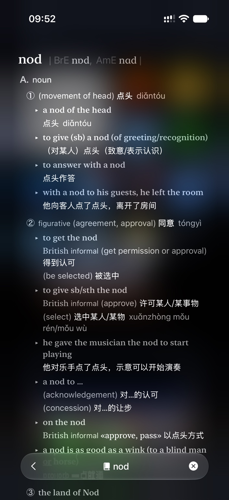
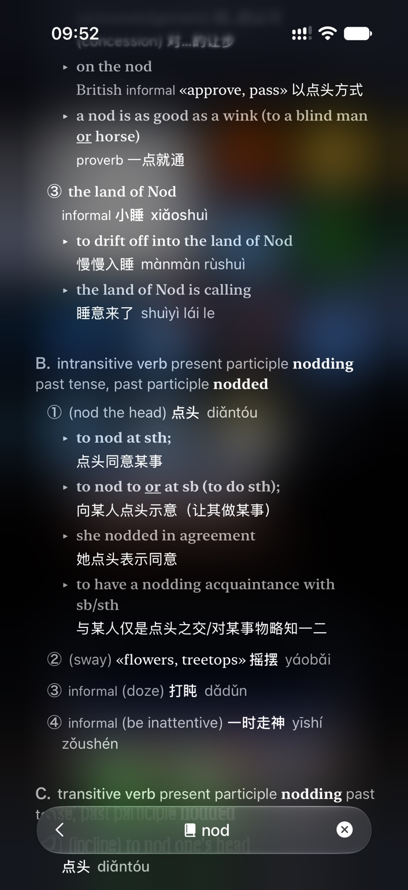
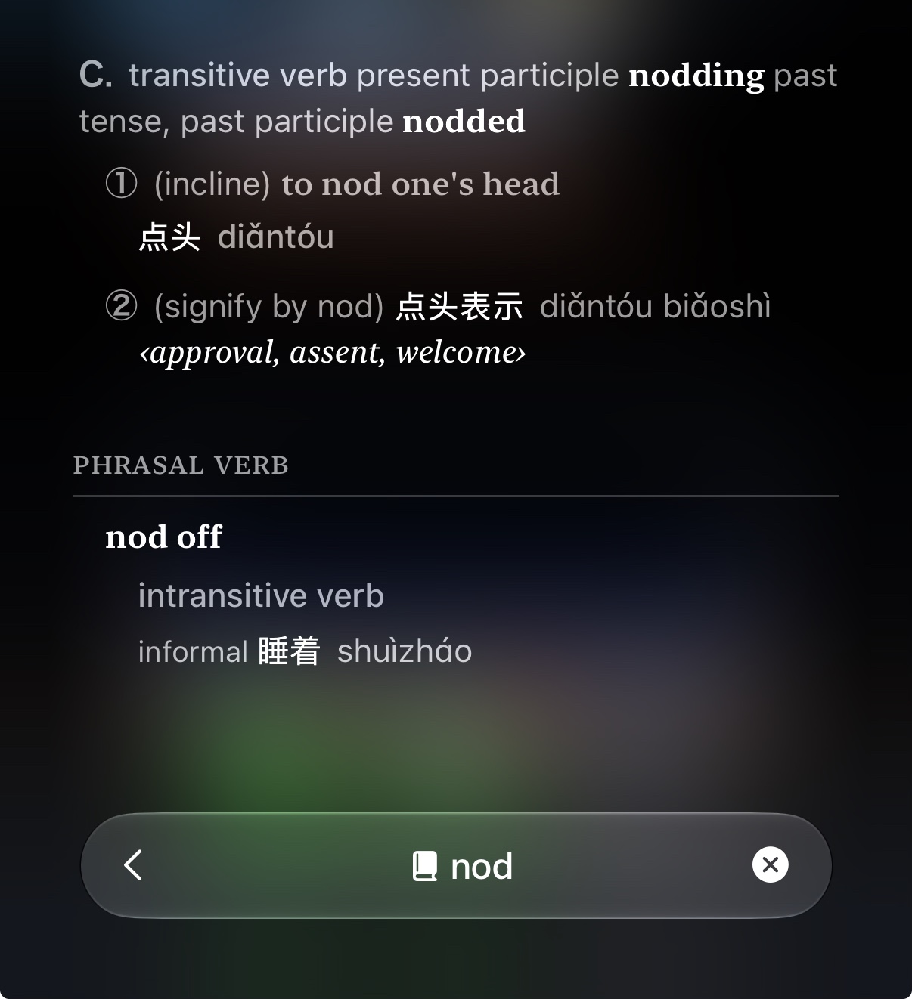

# Round 4 · 新增三张完整词典设计参考审阅

2026-11-07 · **三图均已逐张完整查看；只更新规划，没有实现、测试结果或整改后截图。**

本批为详细词典页设计参考R4-R01–R03，和首次21张问题图R4-P01–P21分开编号。三张不同文件展示同一词的首/中/末不同位置，内容部分重叠；不是24张互不重复的原始问题图。原件字节未改，作为本文参考附件保留，未加入App Asset或生产词库。

规范以[词典补充](https://github.com/whyhaoyu1022-glitch/LexiDawn/blob/6054b03932e036ab3205488ed9e5af60fa7495fa/docs/plans/round-4-dictionary-detail-addendum.md)和[主任务书](https://github.com/whyhaoyu1022-glitch/LexiDawn/blob/6054b03932e036ab3205488ed9e5af60fa7495fa/docs/plans/round-4-development-specification.md)为准；完整元数据/新增36条验收见[机器清单](../../../reviews/round-4-feedback-manifest.json)。

| 参考ID | 原图 | 尺寸 | 字节数 | SHA-256 |
|---|---|---|---|---|
| R4-R01 | `IMG_8884.jpeg` | 706×1536 | 233964 | `bf278dfaea1bf3785281b4a018872b5a017276aa32cb2d5554fabafc67c0a0ba` |
| R4-R02 | `IMG_8885.jpeg` | 706×1536 | 237748 | `92bebef0209a9b1239ad81306ac0b1b48ed994fe3154a923fd105a128b52d050` |
| R4-R03 | `IMG_8886.jpeg` | 1206×1322 | 199267 | `c5ff3b01758f29634d28c07086ebc18af6c0285b60bffec14afb722c1b51b3c1` |

## R4-R01 · IMG_8884.jpeg

**画面事实：** 词头与英美IPA、A名词组、编号义项、语域、搭配及双语例句，底部悬浮返回/词条/关闭条。

**采用：** 衬线词头与音标的主次、词性组标题、义项顺序、搭配/例句缩进、英文及其中文对应；有来源才呈现语域/拼音等信息。

**不照搬：** 不推定参考软件和词典品牌，不将图片内词义转录成生产数据库；不复制底栏压住例句的风险，也不强制每词有双口音或中文拼音。

**对应需求：** F22布局/完整信息、F23可靠来源融合及结构化用户义、F24复习身份一致。

## R4-R02 · IMG_8885.jpeg

**画面事实：** 名词续义与习语、B不及物动词及词形变化、多个义项/例句、C及物动词开头；与首图有内容重叠。

**采用：** 长条目连贯滚动，词形变化附词性组，及物/不及物仅有证据才分组，保留词义/词性对应而非将中文拼成一串。

**不照搬：** 不把同一词的三张图片计成三个词条；不从verb自行推导transitivity，不把引用例句/译文分别错挂到另一个sense。

**对应需求：** F22布局/完整信息、F23可靠来源融合及结构化用户义、F24复习身份一致。

## R4-R03 · IMG_8886.jpeg

**画面事实：** C及物动词续义、短语动词独立分节与短语词头/词性/义项，底部胶囊工具条；末行遮挡风险不照搬。

**采用：** 短语动词独立标题/分隔线和短语词头；紧凑底栏的视觉意图；返回、关闭和生词动作由LexiDawn自身入口语义决定。

**不照搬：** 不让悬浮条盖末行、不硬编码像素宽高；不把nod off自动当作nod的同一复习身份。

**对应需求：** F22布局/完整信息、F23可靠来源融合及结构化用户义、F24复习身份一致。

## 新指令与现有代码核查

- `ReaderFeature.swift`中的DictionaryDetailView/DictionaryResultContent及VocabularyDetailView共享展示需要重构，维持原生SwiftUI与既有导航，不引入WebView或大型UI框架。
- `DictionaryAggregation.swift`当前有Free与Wiktionary适配，**没有OxfordProvider**。牛津为条件接入计划，不能把官方文档调查当真实接入。
- `LearningModels.swift`的VocabularyEntryRecord当前userMeaning为单字符串，尚无本补充所需多词性/例句个人sense结构。
- `ReviewRepository.swift`原题组/选义路径需要和新来源资格及冻结meaningRevision贯通；此前CI成功不是此修改已验收。

本次新增F22–F24、各12条验收、T22–T24；旧F08/F09/F10/F15/F16等冲突条文已同步条件化。原21图批注与事实保留，不回写成负责人当时已提出本次新要求。
